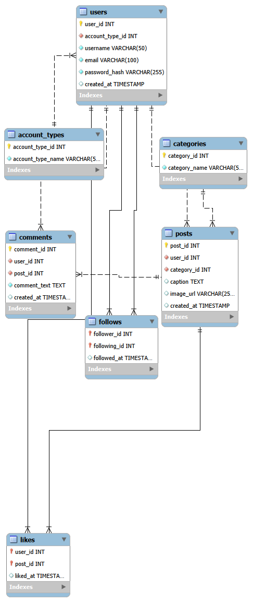

# Instagram Database Management System

A relational database project built with **MySQL 8.0** and **MySQL Workbench**, modeling core Instagram-style features such as accounts, posts, categories, likes, comments, and follows.

## Project overview

The project demonstrates relational database design, primary and foreign keys, sample data insertion, and SQL queries using joins and aggregation.

## Technologies

- MySQL Server 8.0
- MySQL Workbench
- SQL

## Database structure

The database is named `InstagramDB` and contains seven tables:

| Table | Purpose |
| --- | --- |
| `Account_Types` | Defines types of accounts |
| `Users` | Stores user account details and links each user to an account type |
| `Categories` | Defines categories for posts |
| `Posts` | Stores posts, their authors, and categories |
| `Likes` | Records which users like which posts |
| `Comments` | Stores comments made by users on posts |
| `Follows` | Records follower/following relationships between users |

### Relationships

- `Users.account_type_id` references `Account_Types.account_type_id`.
- `Posts.user_id` references `Users.user_id`.
- `Posts.category_id` references `Categories.category_id`.
- `Likes.user_id` references `Users.user_id`; `Likes.post_id` references `Posts.post_id`.
- `Comments.user_id` references `Users.user_id`; `Comments.post_id` references `Posts.post_id`.
- `Follows.follower_id` and `Follows.following_id` both reference `Users.user_id`.

## Entity-relationship diagram



The editable MySQL Workbench model is available in `InstagramDB_ER_Diagram.mwb`.

## Sample data

The seed script populates all seven tables with demonstration records. The verified dataset contained:

| Table | Records |
| --- | ---: |
| Account_Types | 5 |
| Users | 6 |
| Categories | 5 |
| Posts | 15 |
| Likes | 15 |
| Comments | 15 |
| Follows | 15 |

> This dataset is for learning and demonstration, not production use.

## SQL queries

`queries_updated.sql` contains five example queries:

1. **Post details:** Display posts alongside usernames and category names.
2. **Posts by account type:** Show posts from users of a selected account type.
3. **Comments on a post:** Display comments and their authors for a specific post.
4. **Likes per post:** Count likes for each post, including posts with zero likes.
5. **Followers and following:** Show who follows whom.

The queries were executed in MySQL Workbench against the seeded database.

## How to run

1. Install MySQL Server and MySQL Workbench.
2. Connect to your local MySQL server in Workbench.
3. Open `schema.sql` and execute it to create `InstagramDB` and its tables.
4. Open `seed.sql` and execute it to insert the sample records.
5. Open `queries_updated.sql` and execute the queries to view the results.
6. Optionally open `InstagramDB_ER_Diagram.mwb` in Workbench to inspect the editable model.

**Note:** The schema and seed scripts are intended for initial setup. Running inserts repeatedly may cause duplicate-key errors.

## Project files

```text
Database/
├── README.md
├── schema.sql
├── seed.sql
├── queries_updated.sql
├── InstagramDB_ER_Diagram.mwb
└── InstagramDB_ER_Diagram.png
```

## Learning outcomes

- Designed a relational schema with seven connected tables.
- Used primary keys and foreign keys to represent relationships.
- Inserted and verified sample records.
- Wrote SQL queries with joins, filters, grouping, and sorting.
- Reverse-engineered the database into an EER diagram using MySQL Workbench.
